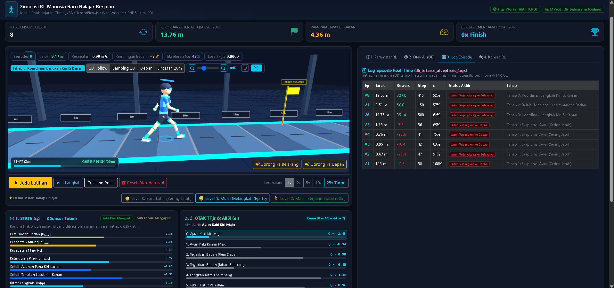

# 3D Humanoid Learning to Walk


-4479A1?logo=mysql&logoColor=white)


Simulasi interaktif berbasis **Web Application** yang dirancang khusus sebagai media pembelajaran **Reinforcement Learning (RL)** untuk mahasiswa. Simulasi ini memvisualisasikan bagaimana karakter **Manusia 3D (*Bipedal Humanoid*)** belajar menjaga keseimbangan dan melangkah dari kondisi belum bisa berdiri (bayi) hingga mahir berjalan mencapai garis finish **20 meter** menggunakan pendekatan Reinforcement Learning dengan Deep Q-Network (DQN) yang menggabungkan metode klasik Q-Learning dengan Deep Neural Network (Jaringan Saraf Tiruan).

---

## 🗄️ Struktur Database (`db_balance_ai`)

File skema database tersedia di [`database/db_balance_ai.sql`](database/db_balance_ai.sql) dan **otomatis dibuat serta diisi (*auto-seed*)** saat aplikasi pertama kali dibuka:

1. **`reward_presets`** — 4 preset skenario praktikum (*Kurikulum Seimbang*, *Fokus Kecepatan Sprint*, *Fokus Postur Tegak*, *Tantangan Lantai Licin*).
2. **`training_sessions`** — Rekapitulasi sesi eksperimen mahasiswa (total episode, rekor jarak terjauh, rata-rata jarak, jumlah keberhasilan finish 20m).
3. **`episode_logs`** — Catatan setiap episode (jarak tempuh, total reward, jumlah langkah, nilai eksplorasi $\epsilon$, *loss* jaringan saraf, dan penyebab jatuh/berhenti).
4. **`saved_models`** — Penyimpanan arsitektur dan tensor bobot jaringan saraf TensorFlow.js (`weights_json`) sehingga model yang sudah pintar berjalan dapat disimpan dan dimuat kembali kapan saja.

---

## 🚀 Cara Menjalankan di Lokal (XAMPP)

1. **Clone / Salin Repositori** ke dalam folder `htdocs` XAMPP Anda:
   ```bash
   C:\xampp\htdocs\REINFORCEMENTLEARNING\autonomous-robot-navigation
   ```
2. **Nyalakan XAMPP**:
   Pastikan modul **Apache** dan **MySQL** berstatus **Running**.
3. **Buka di Browser**:
   Akses URL berikut:
   ```text
   http://localhost/REINFORCEMENTLEARNING/autonomous-robot-navigation/
   ```
   *(Database `db_balance_ai` beserta tabel dan data awalnya akan dibuat secara otomatis oleh sistem).*

---

## 🧪 Panduan Praktikum Singkat untuk Mahasiswa

1. **Amati Tahap Bayi (Level 0)**: Klik tombol **`👶 Level 0: Baru Lahir`**, lalu klik **`▶ Mulai Latih AI`**. Perhatikan bahwa saat nilai Eksplorasi ($\epsilon = 100\%$), manusia 3D memilih aksi otot secara acak sehingga jatuh tersungkur di jarak $0.5\text{ m} - 1.5\text{ m}$.
2. **Percepat Latihan (Turbo 25x)**: Klik kecepatan **`10x`** atau **`25x Turbo`**. Amati grafik kurva belajar yang terus naik dari Episode 1 hingga Episode 15+.
3. **Uji Gangguan Keseimbangan**: Kembalikan kecepatan ke **`1x`**, lalu klik tombol **`💨 Dorong ke Depan`** atau **`💨 Dorong ke Belakang`** saat manusia sedang berjalan. Amati bagaimana jaringan saraf merespons gangguan kemiringan badan secara otomatis!
4. **Eksperimen *Reward Hacking***: Di panel kanan (**Tab 1. Parameter RL**), naikkan *Bobot Hadiah Maju* ke `10.0` dan turunkan *Bobot Keseimbangan Badan Tegak* ke `0.5`. Diskusikan mengapa agen justru menjadi terlalu condong ke depan dan mudah jatuh tersungkur.
5. **Simpan Otak AI ke MySQL**: Buka **Tab 2. Otak AI (DB)**, beri nama model Anda, lalu klik **Simpan Bobot Neural Network ke MySQL**.

---

## 📁 Struktur Direktori Proyek

```text
├── app/
│   ├── config/config.php          # Konfigurasi koneksi MySQL (db_balance_ai)
│   ├── controller/landing.php     # Controller 1-Page Web & Endpoint API JSON
│   ├── core/                      # Core MVC (App, Controller, Database, Security)
│   ├── model/Walker_model.php     # Model transaksi MySQL (episode, sesi, model TF.js)
│   └── view/landing/index.php     # Antarmuka utama 1-Page Web Lab
├── database/
│   └── db_balance_ai.sql          # Skema SQL & Seed Data Awal db_balance_ai
├── public/
│   └── assets/
│       ├── js/
│       │   ├── rl-walker-worker.js # Web Worker: TensorFlow.js DQN/PPO & Fisika Bipedal
│       │   └── walker-3d-app.js    # Three.js 3D Humanoid, Kamera Zoom/Orbit & UI
│       └── vendor/                # Pustaka lokal (Three.js, TensorFlow.js, Chart.js, Bootstrap)
├── preview.png                    #Tempatkan 1 file gambar screenshot simulasi Anda di sini
├── index.php                      # Entry point aplikasi
└── README.md                      # Dokumentasi GitHub
```

---

## 📝 Lisensi

Dikembangkan untuk keperluan edukasi akademik, praktikum mata kuliah **Kecerdasan Buatan (Artificial Intelligence)**, **Machine Learning**, dan **Reinforcement Learning**.
